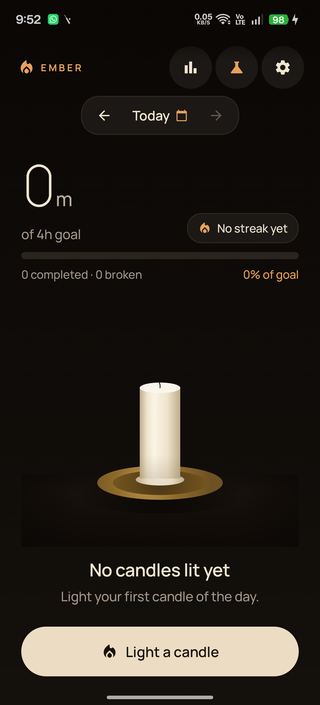
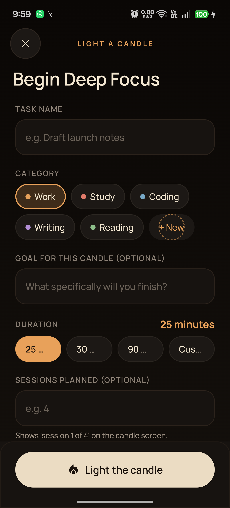
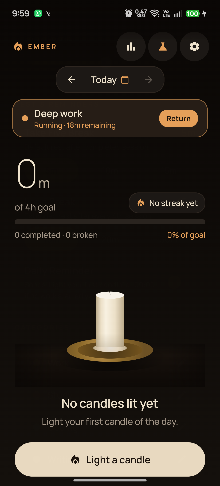
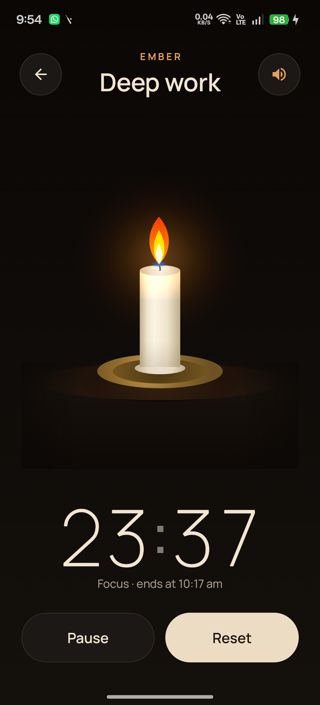
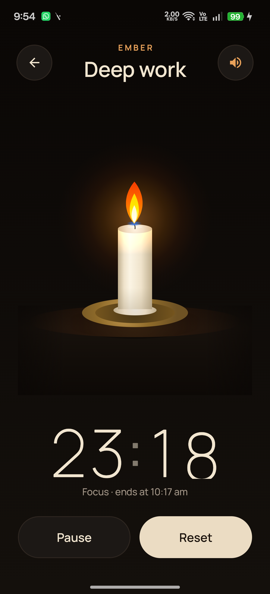
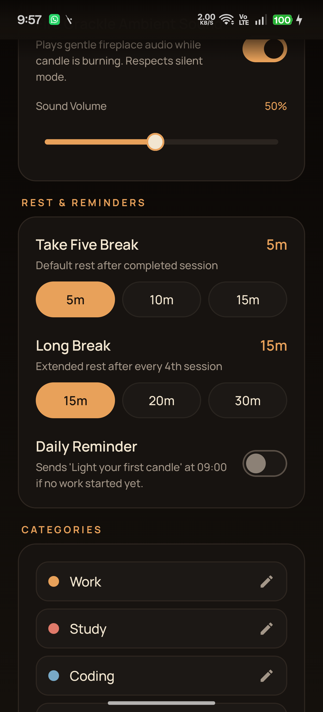
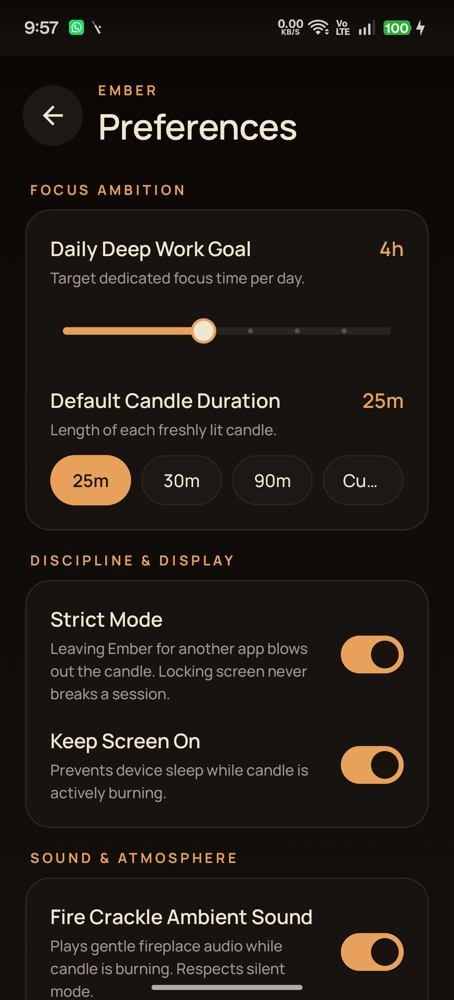
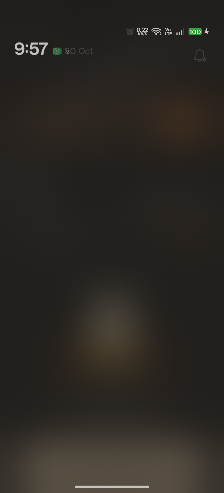

# 🕯️ Ember — Deep-Focus Candle Tracker

<div align="center">

[-3DDC84?style=for-the-badge&logo=android&logoColor=white)](https://android.com)
[](https://kotlinlang.org)
[](https://developer.android.com/jetpack/compose)
[](https://m3.material.io)
[](LICENSE)
[-brightgreen?style=for-the-badge)](#-100-offline--zero-internet-privacy)
[-blue?style=for-the-badge)](#-build--development)

<br/>

**A distraction-free, 100% offline native Android deep-focus companion where every session burns down a tactile, procedurally melting candle.**

*Zero third-party chart or animation libraries · Pure Compose Canvas · 100% Local & Private*

</div>

---

## 📸 Visual Showcase

<div align="center">

| Today Dashboard | Focus (Burning Candle) | Start Session Sheet |
| :---: | :---: | :---: |
|  |  |  |

| Weekly Trends & Ambition | Monthly Activity Heatmap | Ambient Settings & Palette |
| :---: | :---: | :---: |
|  |  |  |

| Focus Ambition & Breaks | Candle Lab (Debug Sandbox) |
| :---: | :---: |
|  |  |

</div>

---

## 🌟 Product Concept & Philosophy

Traditional digital timers feel mechanical, anxiety-inducing, and sterile. **Ember** replaces the cold digital stopwatch with the warm, living presence of a candle in a dark room.

1. **Physical Metaphor**: When you light an Ember, you commit real time. As your countdown ticks, the ivory wax cylinder physically melts down, procedural drips cascade down its flanks, and the flame flickers with organic, tri-harmonic motion.
2. **Strict Accountability Without Invasion**: Deep work requires full immersion. Leaving Ember for another application blows out your candle and marks the session broken. However, it never spies on you: no accessibility services, no usage access permissions, and no penalty for locking your screen or placing your phone face down.
3. **Calm, Distraction-Free Aesthetics**: Warm near-black backgrounds (`#0A0705` to `#14100C`), rich amber accents (`#E8A15A`), cream typography (`#F2E6D0`), and soft wooden table reflections create a sanctuary for concentrated work.
4. **100% Local & Private**: No accounts, no servers, zero telemetry. `android.permission.INTERNET` is completely absent from the manifest. Your deep work history belongs solely to you.

---

## 🕯️ Feature Tour: Everything Ember Does

### 1. The Procedural Candle Engine (Compose Canvas)
Ember contains **zero third-party animation or graphics libraries**. Every pixel of the candle, flame, wick, wax pool, and smoke is rendered using native Jetpack Compose Canvas:
- **Ivory Wax Cylinder**: Directional linear and radial gradients simulate cylindrical wax curvature, subsurface scattering, ambient occlusion at the base (`#8F7F63`), and a burning glow over the top 30% of the candle.
- **Molten Wax Pool**: An elliptical top pool with subtle surface dip, translucent molten wax fill, and an organic specular gloss highlight.
- **Deterministic Seeded Drips**: Drips cascade down the sides based on a deterministic seed derived from the session UUID. As burn progress crosses individual drip thresholds, tear-shaped droplets lengthen with rounded bulbs.
- **4-Layer Harmonic Flame**:
  - Soft cyan-blue base (`#4FC3F7`) representing oxygen combustion.
  - Saturated orange-red outer mantle (`#FF6E40`).
  - Luminous golden-yellow heart (`#FFD54F`).
  - Intense white-hot core (`#FFFFFF`).
- **Tri-Harmonic Flicker Math**: Natural, non-repetitive flame flicker synthesized from three superimposed sine waves:
  $$\text{flicker}(t) = 0.50 \sin(7.1t) + 0.30 \sin(13.7t) + 0.20 \sin(23.3t)$$
- **Ambient Halo & Reflections**: Saturated warm amber halo (`#FF9A3C`, radius $2.2\times$ candle width) rendered with additive blending (`BlendMode.Plus`), casting dynamic light onto the dark wooden table surface and soft contact shadows under the brass dish.
- **Lifecycle Phases**:
  - `IDLE`: Calm unlit ivory candle waiting to be sparked.
  - `IGNITING`: 1-second spark expansion from match to full flame.
  - `BURNING`: Active countdown with harmonic flicker and procedural melting.
  - `PAUSED`: Dimmed ember-like resting glow.
  - `OVERTIME`: Melted wax stub on puddle with steady persistent flame.
  - `FINISHED`: Gentle ascending smoke wisp curving and fading into darkness.
  - `BROKEN`: Quick 0.3s snuff, dark puff of smoke, and cool ash-gray stub tone.
- **Accessibility & Reduced Motion**: Automatically queries `Settings.Global.TRANSITION_ANIMATION_SCALE`. When system animations are disabled, the flame transitions to a peaceful, static configuration with instant transitions.

### 2. Zero-Jitter Timer Reel & Variable Typography
- **Variable Fonts via `FontVariation`**: Bundles the modern geometric sans **Manrope** and luxury serif **Fraunces** (`res/font/`), loaded dynamically across weights:
  - `ExtraLight 200`: Huge 88sp timer digits with tabular figures (`tnum`) and $-2\text{sp}$ letter spacing.
  - `Light 300`: 48sp hero stats numbers and 28sp card values.
  - `Medium 500`: Captions, status lines, and unit badges.
  - `SemiBold 600`: Task titles and interactive buttons.
  - `Bold 700`: Uppercase amber eyebrow kicker labels (`EMBER`).
- **Zero-Jitter Odometer**: Each rolling digit slot is locked to a measured fixed width (52dp), preventing the timer from jittering or shifting layout as numbers roll.
- **Separated Colon**: Colon separators are vertically centered on digit x-height and rendered at 50% opacity.
- **Dynamic Debug Font Switcher**: Debug builds feature an in-app toggle in Settings to switch between Manrope and Fraunces across the app.

### 3. Intelligent Strict Mode & 10-Second Grace Window
- **Anti-Distraction Discipline**: Leaving Ember to browse social media or check feeds blows out your candle and marks the session broken.
- **Phone Lock Friendly**: Tapping the power button or locking the phone does **not** break the session (placing the phone face down is supported). Strict mode checks `PowerManager.isInteractive`.
- **System Overlay Immunity**: Pulling down the notification shade or answering a call only pauses the activity (`onPause`); strict mode is evaluated only when the app is backgrounded (`onStop`).
- **10-Second Grace Window in Foreground Service**:
  - When `onStop` triggers with screen on, a 10-second countdown is started inside `TimerService`.
  - If the user returns within 10 seconds, the grace countdown is cancelled silently.
  - If the grace window expires while the screen is still active, the candle is snuffed out, the session is recorded as `BROKEN`, and an alert notification is issued with the counted focus minutes.
- **Pause & Break Immunity**: Strict mode is intentionally suspended during deliberate pauses and "Take five" break countdowns.

### 4. Today Dashboard & 24-Hour Interactive Timeline
- **Hero Focus Total**: Rendered with `DurationText`—large numerals paired with baseline-aligned, muted cream units (`3h 25m`).
- **Goal Progress Ring & Bar**: 8dp rounded indicator tracking progress toward the daily ambition, automatically displaying a checkmark upon completion.
- **Current Streak Counter**: Displays active consecutive days of deep work alongside a glowing flame icon.
- **Interactive 24-Hour Timeline Strip**:
  - Custom Canvas horizontal strip mapping all sessions of the day.
  - Category-colored solid blocks for completed sessions.
  - Dashed ash-gray blocks for broken sessions.
  - Background hour grid lines and live glowing amber current-time marker.
  - Tap any block to open the session inspection sheet.
- **Chronological Session Cards**: Detailed list cards displaying start/end times, category pill, task title, notes, and ember star ratings.

### 5. Deep Stats & Analytics
- **Weekly Bar Chart**:
  - Custom Canvas bar chart displaying daily focus hours across Monday–Sunday.
  - Today is highlighted in radiant amber.
  - Dashed daily goal baseline spanning across a dedicated 56dp right gutter with right-aligned goal indicator (`4h goal`).
- **Monthly Activity Heatmap**:
  - Full calendar grid where each day block glows with amber saturation proportional to deep work minutes logged.
  - Interactive day selection with inspection popups.
- **Smart Metric Cards**:
  - **Completion Rate**: Calculated strictly as $\frac{\text{completed}}{\text{completed} + \text{broken}}$ (displays `—` when no sessions exist).
  - **Average Quality**: 1–5 star rating aggregate across completed sessions.
  - **Longest Session**: Peak uninterrupted deep-work block.
  - **Best Day**: Highest volume focus day recorded.

### 6. Mindful Breaks & Post-Session Reflections
- **"Take Five" Short Breaks**: Automatically prompted after every session (configurable to 5, 10, or 15 minutes).
- **Long Breaks**: Extended recovery periods (15, 20, or 30 minutes) recommended after every 4 completed sessions.
- **Post-Session Reflection**: Quick modal upon session completion:
  - 1–5 star rating for focus depth.
  - Goal achieved toggle.
  - Rich text reflection notes archived directly in Room SQLite.

### 7. Sensory Immersion & Ambient Audio
- **Fireplace Crackle**: Authentic looping crackle audio (`fire_crackle.wav`).
- **Audio Focus Aware**: Utilizes Android `AudioFocusRequest` to duck or pause audio during incoming phone calls or other media playback.
- **Ringer & Silent Mode Aware**: Queries `AudioManager.ringerMode` to ensure ambient audio never sounds when the device is set to Silent or Vibrate.

### 8. Custom Categories & Ambient Ambition
- **8 Dark-Friendly Palette Colors**: Work (Amber `#E8A15A`), Study (Coral `#E07A6A`), Coding (Sky `#78A9C7`), Writing (Violet `#B38FD6`), Reading (Sage `#8DBE8A`), Straw (`#D9C46A`), Teal (`#5FBFAE`), Rose (`#D98BB0`).
- **Category Manager**: Add, edit, recolor, and archive custom categories.
- **Ambition Slider (`EmberSlider`)**: Continuous daily goal slider from 1 to 12 hours with 15-minute granularity, custom 20dp thumb with amber ring, and hour tick marks.

### 9. Scheduled Reminders & Glance Home Widget
- **Daily Reminder Worker**: WorkManager background job scheduling a gentle daily focus reminder (default 9:00 AM) with selectable active weekdays (`M T W T F S S`). Handles Android 13+ `POST_NOTIFICATIONS` runtime permissions gracefully.
- **AndroidX Glance Home-Screen Widget**: 2x2 and 4x2 responsive home-screen widget showing today's focus progress ring, burned hours, and active streak flame.

### 10. Candle Lab (Debug Sandbox)
- Built exclusively into debug builds (`BuildConfig.DEBUG == true`).
- Scrub candle progress from 0% to 100% in real time.
- Manually trigger all 7 candle states.
- Randomize drip seeds with dice button to test procedural wax distributions.
- Toggle between Manrope and Fraunces typography live.

---

## 🔒 100% Offline & Zero-Internet Privacy

```xml
<!-- AndroidManifest.xml -->
<manifest xmlns:android="http://schemas.android.com/apk/res/android">
    <!-- ZERO INTERNET PERMISSION DECLARED -->
    <uses-permission android:name="android.permission.FOREGROUND_SERVICE" />
    <uses-permission android:name="android.permission.FOREGROUND_SERVICE_SPECIAL_USE" />
    <uses-permission android:name="android.permission.POST_NOTIFICATIONS" />
    <uses-permission android:name="android.permission.RECEIVE_BOOT_COMPLETED" />
    <uses-permission android:name="android.permission.VIBRATE" />
    <uses-permission android:name="android.permission.WAKE_LOCK" />
    ...
</manifest>
```

- **Zero Tracking**: No Google Analytics, no Firebase, no crash telemetry SDKs, no ad networks.
- **Local SQLite Storage**: All session logs, tasks, reflections, and settings remain on your physical device.
- **Cloud-Sync Ready**: Built with a swappable `SyncService` architecture, UUIDv4 primary keys, timestamps, and soft-delete flags—ready for future end-to-end encrypted sync without database migrations.

---

## 🏗️ Architecture & Technology Stack

Ember is built following modern Android architectural standards: **Clean Architecture** with **MVVM** and **Unidirectional Data Flow (UDF)**.

```
┌────────────────────────────────────────────────────────┐
│                   UI Layer (Compose)                   │
│  TodayScreen  FocusScreen  StatsScreen  SettingsScreen │
│              EmberTheme · CandleView Canvas            │
└───────────────────────────▲────────────────────────────┘
                            │ StateFlow / Intents
┌───────────────────────────┴────────────────────────────┐
│                    ViewModels (Hilt)                   │
│   TodayViewModel  FocusViewModel  StatsViewModel       │
└───────────────────────────▲────────────────────────────┘
                            │ Clean Domain Calls
┌───────────────────────────┴────────────────────────────┐
│                   Domain Layer (Pure)                  │
│     TimerEngine · SessionStatsUtils · Models           │
└───────────────────────────▲────────────────────────────┘
                            │ Repository Interfaces
┌───────────────────────────┴────────────────────────────┐
│                    Data Layer (Room)                   │
│   EmberDatabase (KSP) · DataStore · DAOs · Entities    │
└────────────────────────────────────────────────────────┘
```

### Dependencies & Versions

| Component | Library / Version | Purpose |
| :--- | :--- | :--- |
| **Language** | Kotlin `2.3.20` | Modern, expressive, type-safe language |
| **UI Framework** | Jetpack Compose BOM `2026.03.01` | Declarative UI without XML |
| **Design System** | Material 3 `1.4.0` | Base tokens heavily customized to warm dark theme |
| **Dependency Injection** | Dagger Hilt `2.60.1` | Clean, decoupled dependency graph |
| **Database** | Room SQLite `2.7.0` (KSP) | Schema-versioned offline data storage |
| **Preferences** | AndroidX DataStore `1.1.1` | Asynchronous key-value settings storage |
| **Foreground Service** | AndroidX Core `1.15.0` | Background timer engine with low-power notification |
| **Background Scheduling** | WorkManager `2.10.0` | Reliable daily reminder scheduling |
| **App Widget** | AndroidX Glance `1.1.1` | Declarative home screen app widget |
| **Compiler Optimization** | R8 Full Mode | Proguard rules, code shrinking, and 2.6 MB release APK |

---

## 📁 Project Structure

```
app/src/main/kotlin/app/ember/focus/
├── core/
│   ├── audio/            # AmbientSoundPlayer with AudioFocus & Ringer awareness
│   ├── time/             # Injectable Clock interface and SystemClockImpl
│   └── timer/            # Pure Kotlin TimerEngine state machine & TimerModel
├── data/
│   ├── local/            # Room EmberDatabase, DAOs, and SQLite Entities
│   ├── repository/       # Repository implementations (Session, Category, Settings)
│   └── sync/             # NoOpSyncService (Cloud-sync readiness abstraction)
├── di/                   # Dagger Hilt modules (DatabaseModule, RepositoryModule)
├── domain/
│   ├── model/            # Pure domain models (Session, Task, Category, UserSettings)
│   ├── repository/       # Domain repository contracts
│   ├── sync/             # SyncService interface definition
│   └── util/             # Pure calculation helpers (Streaks, DurationText, Drips)
├── navigation/           # Compose Navigation graphs and Screen routes
├── service/              # TimerService (Foreground), DailyReminderWorker, BootReceiver
├── ui/
│   ├── candle/           # CandleView (Procedural Canvas), CandleState, CandleLabScreen
│   ├── common/           # EmberSwitch, EmberChip, EmberSlider, Scrims, DurationText
│   ├── focus/            # FocusScreen, RollingDigits odometer, BreakScreen, ReflectionSheet
│   ├── onboarding/       # 3-step introductory flow with pager
│   ├── settings/         # SettingsScreen & SettingsViewModel
│   ├── stats/            # StatsScreen, StatsCharts (Canvas Bar & Heatmap), StatsViewModel
│   ├── theme/            # Color.kt (CategoryPalette), Type.kt (Manrope/Fraunces), Theme.kt
│   └── today/            # TodayScreen, StartSessionScreen, TodayTimeline, SessionDetailSheet
└── widget/               # EmberWidget (AndroidX Glance home screen widget)
```

---

## 🛠️ Build & Development

### Prerequisites
- **Android Studio Ladybug (or newer)** or command-line SDK tools
- **JDK 17+** (JDK 21 recommended)
- **Android SDK Platform 36** (Target/Compile SDK 36, Min SDK 26)

### Gradle Commands

```bash
# 1. Build Debug APK
./gradlew assembleDebug
# Output: app/build/outputs/apk/debug/app-debug.apk

# 2. Build Minified Production Release APK
./gradlew assembleRelease
# Output: app/build/outputs/apk/release/app-release-unsigned.apk (2.6 MB)

# 3. Execute Unit Tests (State Machine, Stats Rules, Clock Recovery)
./gradlew test

# 4. Execute Instrumented UI Tests on Device / Emulator
./gradlew connectedAndroidTest

# 5. Run Android Lint Validation
./gradlew lintDebug
```

---

## 🧪 Testing & Quality Assurance

- **Unit Tests (`app/src/test/`)**:
  - `TimerEngineTest`: State machine transitions (`IDLE`, `RUNNING`, `PAUSED`, `OVERTIME`, `COMPLETED`, `BROKEN`), monotonic clock advancement, midnight crossings, heartbeat persistence, and reboot recovery.
  - `SessionStatsAndRulesTest`: Daily goal progress computation, "Session X of N" plan labels, multi-day streak calculations, and completion rate formulas.
- **Instrumented UI Tests (`app/src/androidTest/`)**:
  - `ComposeUiTest`: Start session form validation, category selection, session card rendering, and CandleView composition across lifecycle phases.
- **Device Verification**:
  - Verified across multiple physical devices and emulator viewports: 360×800 dp, 390×844 dp, and 412×915 dp.
  - Edge-to-edge transparent system bar padding with gradient scrims (`Modifier.safeDrawingPadding()`).

---

## 📜 License

This project is licensed under the **MIT License** — see the [LICENSE](LICENSE) file for details.

```
Copyright (c) 2026 Sumiraj saroj
```
